<p align="center">
  
</p>

<p align="center">
  <a href="https://herra310.github.io/Portfolio/"><b>Portafolio</b></a>
  &nbsp;·&nbsp;
  <a href="https://www.linkedin.com/in/jorge-arath-herrera-romero-146013214/">LinkedIn</a>
  &nbsp;·&nbsp;
  <a href="https://twitter.com/Herra310">X / Twitter</a>
  &nbsp;·&nbsp;
  <a href="mailto:jorgehr99jhr@gmail.com">Correo</a>
</p>

<br>

```txt
 ┌─ PARTIDA GUARDADA ───────────────────────────────────┐
 │                                                      │
 │  JUGADOR ......... Jorge A. Herrera                  │
 │  CLASE ........... Desarrollador web                 │
 │  NIVEL ........... 3  (años de experiencia)          │
 │  ARMA PRINCIPAL .. C# / .NET                         │
 │  ARMA SECUNDARIA . Vue 3                             │
 │  COMPAÑERO ....... un gato (ver el final)            │
 │                                                      │
 └──────────────────────────────────────────────────────┘
```

¡Hola! Soy Jorge. Construyo aplicaciones web con **C#, .NET y Vue 3**, y me gusta usar la creatividad para resolver problemas y cuidar los detalles de lo que entrego.

### `▸ INVENTARIO`

**Equipado**


**En la mochila**


<sub>+ SQL Server, que también va en la mochila aunque aquí no tenga ícono.</sub>

<br>

### `▸ HABILIDAD PASIVA: COMPAÑERO IA`

Uso **Claude Code** como una herramienta más del stack: escribo skills y reglas de proyecto, configuro hooks y conecto herramientas por MCP para automatizar lo repetitivo y dedicarle más tiempo a lo que sí importa.

<br>

```txt
 GUARDANDO PARTIDA... ████████████████████ 100%
 No apagues la consola.
```

<p align="center">
  
  <br>
  <sub>¿Continuar? &nbsp;<a href="https://herra310.github.io/Portfolio/"><b>▶ SÍ</b></a>&nbsp;&nbsp; NO</sub>
</p>
